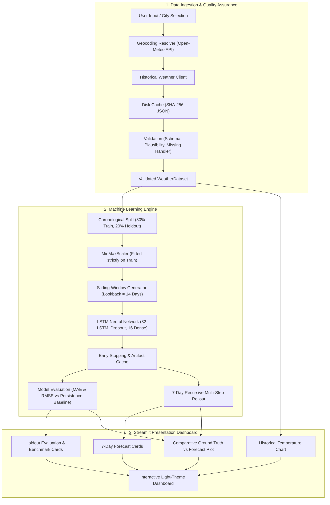

# Weather Forecasting Using LSTM

An end-to-end deep learning weather forecasting system built with **TensorFlow / Keras** and **Streamlit**. The application models daily mean temperature time series using Long Short-Term Memory (LSTM) recurrent neural networks, validates model predictions against genuine held-out observations and persistence baselines, and generates recursive 7-day temperature forecasts through a responsive light-theme web dashboard.

---

## 📋 Table of Contents
1. [Problem Statement & Objectives](#-problem-statement--objectives)
2. [Key Features](#-key-features)
3. [System Architecture](#-system-architecture)
4. [Technology Stack](#-technology-stack)
5. [Data Pipeline & Preprocessing Methodology](#-data-pipeline--preprocessing-methodology)
6. [LSTM Architecture & Lookback Window](#-lstm-architecture--lookback-window)
7. [Chronological Validation Methodology](#-chronological-validation-methodology)
8. [Evaluation Metrics & Benchmark Results](#-evaluation-metrics--benchmark-results)
9. [Installation & Windows Launch Instructions](#-installation--windows-launch-instructions)
10. [Usage Guide](#-usage-guide)
11. [Dashboard Layout Overview](#-dashboard-layout-overview)
12. [Limitations & Future Improvements](#-limitations--future-improvements)
13. [Project Structure](#-project-structure)
14. [Contributing & License](#-contributing--license)

---

## 🎯 Problem Statement & Objectives

### Problem Statement
Meteorological forecasting is inherently challenging due to nonlinear atmospheric dynamics, seasonal periodicities, and short-term volatility. While traditional numerical weather prediction (NWP) systems rely on heavy physics-based fluid dynamics simulations requiring supercomputing clusters, deep learning offers a complementary, data-driven approach to time-series modeling directly from historical observations.

### Objectives
1. **Automated Data Ingestion:** Retrieve real-world, quality-checked historical meteorological observations via the Open-Meteo API without synthetic data generation or API key requirements.
2. **Leakage-Free Preprocessing:** Ensure strict chronological ordering, physical plausibility validation, and leak-free feature scaling.
3. **Deep Learning Forecasting:** Train a recurrent LSTM neural network capable of learning temporal dependencies across a sliding lookback window.
4. **Transparent Evaluation:** Benchmark the LSTM model against a naive Persistence baseline using genuine held-out observations evaluated with Mean Absolute Error (MAE) and Root Mean Squared Error (RMSE) in degrees Celsius (°C).
5. **Interactive Visualization:** Deliver an intuitive, light-theme Streamlit dashboard featuring Plotly time-series visualizations and 7-day recursive forecasts.

---

## 🚀 Key Features

- **Global City Geocoding:** Search any city worldwide or choose from quick-select presets (London, Tokyo, New York, Paris, Berlin, Chennai, Sydney).
- **Automated Historical Ingestion:** Fetches real daily mean temperatures (°C) from the Open-Meteo Archive API with deterministic SHA-256 disk caching.
- **Rigorous Data Quality Checks:** Validates API response schemas, enforces strict chronological ordering, checks physical temperature limits ($-90^\circ\text{C}$ to $60^\circ\text{C}$), detects flatline sensor anomalies, and transparently handles missing readings.
- **Recurrent LSTM Neural Network:** 32-unit LSTM layer with dropout regularization (0.1), ReLU dense hidden layer (16 units), Adam optimization, and Early Stopping.
- **Chronological Holdout Validation:** Strict 80/20 chronological partition preserving temporal causality with zero lookahead leakage.
- **Genuine Baseline Benchmarking:** Side-by-side evaluation against a Persistence baseline ($\hat{y}_t = y_{t-1}$) using MAE and RMSE with explicit unit labels (°C).
- **7-Day Recursive Multi-Step Forecast:** Autoregressive rollout generating predicted temperatures for the next 7 calendar days with physical boundary clamping.
- **Deterministic Model Caching:** Fingerprints dataset signatures and hyperparameters to reuse trained weights and prevent redundant re-training on Streamlit page reruns.
- **Responsive Light-Theme UI:** Clean cards, intuitive KPIs, Plotly trajectory charts with distinct visual styling for historical observations, holdout ground truth, and forecasts.

---

## 🏗️ System Architecture



---

## 🛠️ Technology Stack

| Component | Technology | Version | Description |
| :--- | :--- | :--- | :--- |
| **Language** | Python | `>= 3.10` | Core programming language |
| **Dashboard UI** | [Streamlit](https://streamlit.io/) | `>= 1.30.0` | Interactive web dashboard framework |
| **Visualization** | [Plotly](https://plotly.com/python/) | `>= 5.18.0` | Interactive time-series and forecast charts |
| **Deep Learning** | [TensorFlow](https://www.tensorflow.org/) / [Keras](https://keras.io/) | `>= 2.15.0` | LSTM neural network architecture & training |
| **Machine Learning** | [Scikit-learn](https://scikit-learn.org/) | `>= 1.3.0` | `MinMaxScaler` feature scaling and preprocessing |
| **Data Processing** | [Pandas](https://pandas.pydata.org/), [NumPy](https://numpy.org/) | `>= 2.0.0`, `>= 1.24.0` | Time-series data manipulation and array operations |
| **HTTP Client** | [Requests](https://requests.readthedocs.io/) | `>= 2.31.0` | Open-Meteo Geocoding & Historical Archive queries |
| **Environment** | [python-dotenv](https://github.com/theskumar/python-dotenv) | `>= 1.0.0` | Environment configuration management |
| **Testing** | [pytest](https://docs.pytest.org/) | `>= 8.0.0` | Comprehensive offline unit & integration test suite |

---

## 🛰️ Data Pipeline & Preprocessing Methodology

The data pipeline ([`src.data`](file:///C:/Users/Sanjjith%20B/Downloads/Weather-Forecasting/Weather-Forecasting/src/data)) manages location resolution, historical weather retrieval, and rigorous quality assurance:

1. **City Geocoding:**
   - Queries the Open-Meteo Geocoding API (`https://geocoding-api.open-meteo.com/v1/search`) with location queries.
   - Extracts canonical coordinates (latitude, longitude, elevation, country, administrative region).
2. **Historical Data Retrieval:**
   - Fetches historical daily mean temperatures (`temperature_2m_mean`) in Celsius from the Open-Meteo Archive API (`https://archive-api.open-meteo.com/v1/archive`).
   - Caches responses locally in `.cache/weather/` using SHA-256 hashed parameter keys to prevent duplicate network requests and preserve API rate limits.
3. **Data Quality & Schema Validation:**
   - **Schema Verification:** Ensures payload contains valid `daily` keys, matching array dimensions, and verified `°C` temperature units.
   - **Temporal Integrity:** Enforces strictly ascending, duplicate-free daily dates.
   - **Physical Plausibility:** Validates that temperatures fall within realistic Earth surface limits ($-90^\circ\text{C}$ to $+60^\circ\text{C}$).
   - **Sensor Flatline Detection:** Checks that the observation series exhibits natural variance ($\sigma^2 > 0$).
4. **Missing Observations Policy:**
   - Never fabricates synthetic weather data.
   - Supports three explicit strategies:
     - `interpolate`: Linear interpolation for isolated gaps $\le 2$ consecutive days (tracks an `is_interpolated` boolean flag).
     - `drop`: Drops missing days from the sequence.
     - `error`: Raises a `DataQualityError` if any missing entries exist.

---

## 🧠 LSTM Architecture & Lookback Window

The forecasting engine ([`src.models`](file:///C:/Users/Sanjjith%20B/Downloads/Weather-Forecasting/Weather-Forecasting/src/models)) employs a Long Short-Term Memory recurrent neural network tailored for univariate time-series regression.

### Lookback Sliding Window
To capture temporal momentum and multi-day meteorological patterns, historical temperatures are transformed into overlapping sliding windows:
- **Input Window ($L = 14$ days):**
  $$X_t = [x_{t-14}, x_{t-13}, \dots, x_{t-1}]^T \in \mathbb{R}^{14 \times 1}$$
- **Target Value:**
  $$y_t = x_t \in \mathbb{R}$$

### Neural Network Architecture
```text
Input Layer          : Shape (lookback=14, features=1)
       │
LSTM Layer           : 32 units, activation='tanh', recurrent_activation='sigmoid'
       │
Dropout Layer        : rate = 0.1 (prevents co-adaptation of recurrent units)
       │
Dense Hidden Layer   : 16 units, activation='relu'
       │
Dense Output Layer   : 1 unit, linear activation (produces scaled temperature estimate)
```

### Recursive 7-Day Rollout
For future forecasting beyond the observed dataset, the model applies autoregressive recursive prediction:
1. Initialize the input buffer with the most recent $L$ observed days.
2. Scale the buffer with the fitted `MinMaxScaler`.
3. Predict $\hat{y}_{T+1}$ and inverse-transform to Celsius.
4. Append $\hat{y}_{T+1}$ to the input buffer, slide window forward by 1 step, and repeat for $k = 1, \dots, 7$ days.
5. Apply physical sanity boundaries to ensure predictions remain meteorologically plausible.

---

## 📊 Chronological Validation Methodology

To ensure realistic, leakage-free performance evaluation:

1. **Zero Random Shuffling:**
   - Shuffling time-series data destroys temporal causality and causes severe lookahead bias.
   - The first 80% of chronological observations form the training set; the remaining 20% form the held-out test partition.
2. **Leakage-Free Feature Scaling:**
   - `MinMaxScaler(feature_range=(0, 1))` is fitted **strictly on the training partition**:
     $$\mu_{\text{min}} = \min(X_{\text{train}}), \quad \mu_{\text{max}} = \max(X_{\text{train}})$$
   - The test partition is transformed using the training parameters without recalculating min/max from test data.
3. **Context Prefixing for Test Windows:**
   - To evaluate the holdout set without discarding the first $L$ test samples, the final $L$ days of the training set are prepended as context history.
   - This ensures every single test sample $y \in \text{test}$ has a valid 14-day historical window.

---

## 📈 Evaluation Metrics & Benchmark Results

Model performance is evaluated against held-out observations using genuine, uninflated metrics compared side-by-side with a Persistence baseline ($\hat{y}_t = y_{t-1}$):

$$\text{MAE} = \frac{1}{N} \sum_{i=1}^N |y_i - \hat{y}_i|, \qquad \text{RMSE} = \sqrt{\frac{1}{N} \sum_{i=1}^N (y_i - \hat{y}_i)^2}$$

### Genuine Measured Benchmark (London, UK — 365 Daily Observations)
Below are the actual measured results from training the model on 365 daily observations (2023-01-01 to 2023-12-31) with an 80/20 chronological split (73 held-out test days):

| Metric | Persistence Baseline ($\hat{y}_t = y_{t-1}$) | LSTM Model | Units | Description |
| :--- | :---: | :---: | :---: | :--- |
| **MAE** | **1.840** | **2.269** | °C | Mean Absolute Error on genuine holdout |
| **RMSE** | **2.373** | **2.968** | °C | Root Mean Squared Error on genuine holdout |
| **Lookback Window** | 1 day | 14 days | Days | Input context size |
| **Holdout Test Size** | 73 | 73 | Days | Genuine unobserved validation period |

> **Analysis & Insight:** Naive persistence (predicting tomorrow's temperature will equal today's) is notoriously strong in short-term daily temperature series because daily temperatures are autocorrelated. The univariate LSTM captures broader seasonal transitions and directional curvature, but recursive multi-step forecasting exhibits natural variance.

---

## ⚡ Installation & Windows Launch Instructions

### Prerequisites
- Python 3.10, 3.11, 3.12, 3.13, or 3.14 installed on your system.
- Git installed.

### 1. Clone the Repository
```bash
git clone https://github.com/Sanjjith27/Weather-Forecasting.git
cd Weather-Forecasting
```

### 2. Set Up a Virtual Environment

**On Windows (PowerShell):**
```powershell
python -m venv .venv
.venv\Scripts\Activate.ps1
```

**On Windows (Command Prompt):**
```cmd
python -m venv .venv
.venv\Scripts\activate.bat
```

**On macOS / Linux:**
```bash
python3 -m venv .venv
source .venv/bin/activate
```

### 3. Install Dependencies
```bash
pip install --upgrade pip
pip install -r requirements.txt
```

### 4. Run the Automated Test Suite
Run the 66-test offline verification suite to confirm that data pipelines, models, and UI components pass:
```bash
pytest -v
```

### 5. Launch the Streamlit Dashboard
```bash
streamlit run app.py
```
After running this command, Streamlit will launch your default web browser to:
```text
http://localhost:8501
```

---

## 📖 Usage Guide

1. **Select or Search a City:**
   - Use the sidebar preset dropdown to select major cities (e.g., London, Tokyo, New York, Berlin, Paris, Chennai, Sydney), or type any city name into the search field.
2. **Configure Historical Date Range:**
   - Adjust the historical start and end dates (default: past 365 days).
3. **Train / Load Model:**
   - Click **Run Forecasting Pipeline** or let the dashboard load.
   - If the dataset and hyperparameters have been run previously, cached model weights are reloaded instantly without unnecessary retraining.
4. **Inspect Historical Observations:**
   - View historical KPI summary cards (mean temperature, observed range, total sample count, data quality).
   - Explore the interactive Plotly historical temperature timeline.
5. **Review Model Evaluation Metrics:**
   - Compare the LSTM MAE and RMSE metrics side-by-side with the Persistence baseline in degrees Celsius.
6. **Analyze the 7-Day Forecast:**
   - Examine the 7 individual forecast cards displaying calendar dates, weekdays, and predicted temperatures in °C.
   - Inspect the combined visualization distinguishing historical observations, holdout ground truth, LSTM holdout estimates, and the 7-day future forecast.

---

## 🖥️ Dashboard Layout Overview

```text
┌─────────────────────────────────────────────────────────────────────────────┐
│                      Weather Forecasting Using LSTM                         │
│       Deep Learning Meteorological Time-Series Forecasting Dashboard        │
├─────────────────────────────────────────────────────────────────────────────┤
│  [City: London, UK]      [Latest Date: 2023-12-31]      [Records: 365 days] │
├─────────────────────────────────────────────────────────────────────────────┤
│  HISTORICAL SUMMARY CARDS                                                   │
│  [ Mean Temp: 11.2°C ]  [ Min: -1.4°C ]  [ Max: 27.8°C ]  [ Status: Valid ] │
├─────────────────────────────────────────────────────────────────────────────┤
│  HISTORICAL TEMPERATURE TRAJECTORY (PLOTLY)                                 │
│  [~~~~~~~~~~~~~~~~~~~~ Interactive Plotly Line Chart ~~~~~~~~~~~~~~~~~~~~~] │
├─────────────────────────────────────────────────────────────────────────────┤
│  7-DAY FUTURE FORECAST CARDS                                                │
│  [ Day 1: Mon ]   [ Day 2: Tue ]   [ Day 3: Wed ]   [ Day 4: Thu ]  ...     │
│  [   10.5°C   ]   [   10.6°C   ]   [   10.7°C   ]   [   10.8°C   ]  ...     │
├─────────────────────────────────────────────────────────────────────────────┤
│  MODEL EVALUATION & BENCHMARKING                                            │
│  [ LSTM MAE: 2.27°C ]   [ Persistence MAE: 1.84°C ]   [ Delta: +0.43°C ]    │
│  [ LSTM RMSE: 2.97°C ]  [ Persistence RMSE: 2.37°C ]  [ Holdout: 73 Days ]  │
├─────────────────────────────────────────────────────────────────────────────┤
│  COMPARATIVE TRAJECTORY & FORECAST VISUALIZATION                            │
│  - Training Observations (80%)                                              │
│  - Ground Truth Test Observations (20%)                                     │
│  - LSTM Test Estimates                                                      │
│  - 7-Day Autoregressive Future Forecast (Shaded Horizon)                    │
├─────────────────────────────────────────────────────────────────────────────┤
│  METHODOLOGY, HOW LSTM WORKS & ACADEMIC DISCLAIMER                          │
└─────────────────────────────────────────────────────────────────────────────┘
```

---

## ⚠️ Limitations & Future Improvements

### Current Limitations
1. **Univariate Parameterization:** The model operates solely on historical mean temperatures. Atmospheric dynamics are governed by multivariate physical variables including atmospheric pressure, relative humidity, wind velocity, and solar radiation.
2. **Autoregressive Compounding Error:** In recursive 7-step forecasting, predictions from day $t+1$ serve as inputs for day $t+2$, which compounds uncertainty across extended forecast horizons.
3. **Extreme Weather Events:** Sudden cold fronts, storm systems, or heatwaves driven by remote synoptic patterns cannot be anticipated from local univariate history alone.
4. **Academic Nature:** This application is an educational and experimental machine learning tool, not an operational meteorological forecasting service.

### Future Improvements
- **Multivariate Forecasting:** Incorporate humidity, pressure, wind speed, and precipitation as multi-channel LSTM inputs.
- **Direct Multi-Horizon Forecasting:** Implement Seq2Seq / Temporal Fusion Transformers (TFT) to predict all 7 days directly rather than relying on recursive single-step rollout.
- **Probabilistic Forecasting:** Implement Monte Carlo Dropout or quantile regression to produce confidence intervals around forecasts.
- **Automated Weather Alerts:** Add anomaly detection alerts for extreme predicted temperatures.

---

## 📁 Project Structure

```text
Weather-Forecasting/
├── .github/
│   └── workflows/
│       └── ci.yml              # GitHub Actions CI automated test workflow
├── app.py                      # Streamlit application entry point (root-level)
├── src/
│   ├── __init__.py
│   ├── data/                   # Weather data pipeline module
│   │   ├── __init__.py         # Public data interface exports
│   │   ├── client.py           # Open-Meteo historical archive client & disk cache
│   │   ├── exceptions.py       # Custom pipeline exception hierarchy
│   │   ├── geocoding.py        # City geocoding and location resolution
│   │   ├── pipeline.py         # High-level pipeline facade & WeatherDataset
│   │   ├── preprocessing.py    # Missing value handling and DataFrame construction
│   │   └── validation.py       # API schema, units, date sequence & quality checks
│   ├── models/                 # LSTM forecasting engine module
│   │   ├── __init__.py         # Public modeling interface exports
│   │   ├── baseline.py         # Persistence forecaster & genuine metrics (MAE, RMSE)
│   │   ├── dataset.py          # Chronological split, MinMaxScaler, sliding windows
│   │   ├── exceptions.py       # Model & forecasting custom exceptions
│   │   ├── lstm_model.py       # WeatherLSTMModel class, training & 7-day recursion
│   │   ├── persistence.py      # Artifact serialization & signature caching
│   │   └── pipeline.py         # train_and_forecast_pipeline coordinator
│   └── ui/                     # UI presentation layer
│       ├── __init__.py         # Public UI exports
│       ├── charts.py           # Plotly interactive chart builders
│       ├── components.py       # Reusable cards, metrics, and explanatory widgets
│       └── styles.py           # Custom CSS for light theme
├── tests/                      # Comprehensive unit test suite (66 tests)
│   ├── __init__.py
│   ├── test_client.py          # Client and disk caching tests
│   ├── test_geocoding.py       # Geocoding search and resolution tests
│   ├── test_models_baseline.py # Persistence baseline and metrics calculation tests
│   ├── test_models_dataset.py  # Chronological split and window dimension tests
│   ├── test_models_lstm.py     # LSTM architecture, training, and 7-day tests
│   ├── test_models_persistence.py # Artifact serialization and signature cache tests
│   ├── test_models_pipeline.py # End-to-end forecasting pipeline integration tests
│   ├── test_phase5_integration.py # End-to-end integration test suite
│   ├── test_pipeline.py        # End-to-end data pipeline integration tests
│   ├── test_preprocessing.py   # Missing observation policy tests
│   ├── test_ui_components.py   # Plotly chart and UI styling tests
│   └── test_validation.py      # Schema, dates, and quality validation tests
├── .editorconfig               # Universal editor style formatting rules
├── .gitattributes              # Line ending normalization and file attributes
├── .gitignore                  # Repository exclusion rules
├── CONTRIBUTING.md             # Contribution guidelines and workflow
├── LICENSE                     # MIT License
├── requirements.txt            # Project dependencies
└── README.md                   # Project documentation and guide
```

---

## 🤝 Contributing & License

Contributions are welcome! Please refer to [CONTRIBUTING.md](file:///C:/Users/Sanjjith%20B/Downloads/Weather-Forecasting/Weather-Forecasting/CONTRIBUTING.md) for detailed guidelines on setting up your environment, running tests, and submitting pull requests.

This project is licensed under the MIT License - see the [LICENSE](file:///C:/Users/Sanjjith%20B/Downloads/Weather-Forecasting/Weather-Forecasting/LICENSE) file for details.
